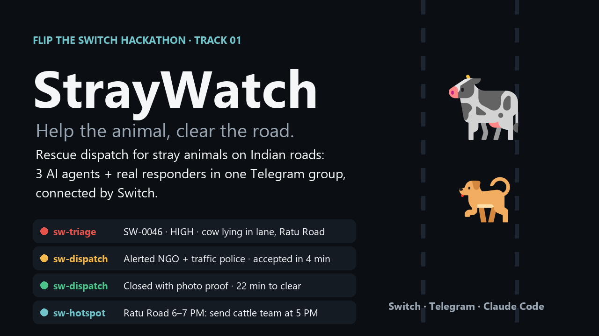
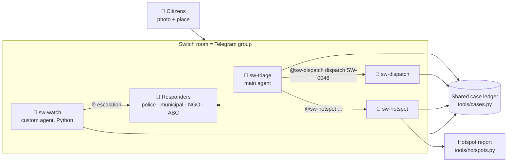

[](https://youtu.be/cfPCFyH-ICA)

# 🐾 StrayWatch: help the animal, clear the road

**Rescue dispatch for stray animals on Indian roads, run by three AI agents and the people in one Telegram group, connected by [Switch](https://github.com/sandbox-quantum/switch).**

Built for the *Flip the Switch* hackathon (WeMakeDevs × DevTools Academy × Switch AI) · Track 01: Best Business Workflow

> 🎥 **Demo video (1:45):** https://youtu.be/cfPCFyH-ICA (also in the repo: [docs/StrayWatch-demo.mp4](docs/StrayWatch-demo.mp4))
>
> 📄 **Solution ideation (theme, problem, idea):** [docs/StrayWatch-Solution-Ideation.pdf](docs/StrayWatch-Solution-Ideation.pdf)

---

## Why

On my way to college in Ranchi, I saw an injured dog lying on the road while vehicles kept passing it. Nobody called anyone, because nobody knew who to call.

Stray cattle and dogs on Indian roads block traffic, cause accidents and get hurt themselves. In 2024, Odisha recorded **437 deaths** from 903 animal–vehicle collisions. Haryana has seen **900+ deaths in 5 years** from stray-cattle accidents.

Police, municipal teams, NGOs and volunteers all exist. Their problem is that they **find out too late and work blind**:

- Reports arrive as scattered calls and WhatsApp forwards, often with no exact location
- The same animal is reported five times by five people
- Nobody knows who is handling a case, so cases get lost in the scroll
- Nobody records where and when it happens, so the same road is dangerous again tomorrow at 6 PM

## What StrayWatch does

A citizen posts a photo and a place in a Telegram group. That's all they do. Then:

| Step | Who | What happens |
|---|---|---|
| 1. Triage | 🤖 `sw-triage` | Reads the text and photo (Hindi/English), asks for the location if missing, files a case, sets urgency **HIGH / CHECK / LOW**, catches duplicates |
| 2. Dispatch | 🤖 `sw-dispatch` | Tags the right responder by name: traffic police for blocked lanes, municipal team for cattle, NGO for injuries, ABC team for aggressive dogs |
| 3. Accept | 🧑 Responder | Replies `accept SW-0046`. Everyone sees who owns the case |
| 4. Escalate | 🤖 `sw-watch` | A custom Switch agent keeps the clock: if nobody accepts within 10 minutes, it posts an escalation tagging the duty coordinator |
| 5. Close with proof | 🧑 + 🤖 | The responder posts a photo. Dispatch **looks at it** and closes the case only if it shows the animal helped or the road clear |
| 6. Prevent | 🤖 `sw-hotspot` | "Ratu Road, 6–7 PM, cattle, 6 cases this week → send the cattle team at 5 PM, before the rush" |

## Why Switch is central

Without Switch, StrayWatch doesn't exist. **The Switch room *is* the dispatch system:**



| Switch feature | How StrayWatch uses it |
|---|---|
| **Telegram bridge** | People report and respond from the app they already use. Nobody installs anything |
| **Agents as teammates** | Three agents with distinct jobs post in the same conversation as humans |
| **Agent-to-agent handoff** | Triage hands cases to dispatch *by name, in the open*, so humans can see and correct every step |
| **Main agent** (`!assign-agent`) | Citizens don't need to know any agent names. Every message reaches triage first |
| **Addressing: anyone** | Citizens and volunteers without a Switch account can talk to the agents |
| **Shared room + shared working directory** | All three agents work from one case ledger, so nobody tracks state in their head |
| **Attachments to agents** | Photos reach the agents, which is what makes *close with photo proof* possible |
| **Templates** | The whole workflow is one YAML file: [`straywatch.template.yaml`](straywatch.template.yaml) |
| **Agent protocol (custom agent)** | [`tools/watcher.py`](tools/watcher.py) registers `sw-watch` through the Switch agent protocol and posts escalations with `POST /agents/{id}/message`. Switch has no scheduler, so this agent keeps the clock |

## Design decisions (and the loopholes they close)

- **LLMs don't decide urgency; code does.** The agents extract facts from messy reports. [`tools/cases.py`](tools/cases.py) applies the rules deterministically, so the same report always gets the same urgency. The rules are covered by [tests](tests/test_cases.py).
- **No made-up locations.** If a report has no place, triage asks one question and waits.
- **Duplicates are merged.** A second report about the same animal on the same road within 60 minutes is attached to the existing case and isn't dispatched again.
- **No case is "done" without proof.** The ledger refuses to close a case without a proof description, and dispatch has to see a photo.
- **Escalation.** Unaccepted cases are escalated after 10 minutes by `sw-watch`, a custom agent that checks the ledger every minute. Dispatch also runs the same check every time it is addressed, so escalation still works if the watcher is off.
- **Animal welfare.** Aggressive dogs go to ABC (sterilisation & vaccination) teams, never "removal". Citizens are always told not to approach injured or aggressive animals.
- **Honest data.** The hotspot history in `data/cases.csv` is **simulated** (`simulated=yes`), generated by [`tools/seed.py`](tools/seed.py) on real Ranchi road names. The report always shows simulated and live counts separately.

## Urgency rules

| Situation | Urgency | Teams |
|---|---|---|
| Lane blocked on a main road / highway, or any road at peak hour (8–11 AM, 5–8 PM) | **HIGH** | Traffic police + cattle team or NGO |
| Injured / lying still / limping | **CHECK** (welfare), **HIGH** if also blocking a busy lane | NGO |
| Aggressive dog near traffic | **HIGH** | ABC team |
| Lane blocked on a minor road, off-peak | **CHECK** | Cattle team or NGO |
| Off the road, not injured | **LOW** | Logged for the hotspot map only |

## Run it yourself (~20 minutes)

**You need:** Docker Desktop, Python 3.10+, a Telegram account with a @username, and Claude Code (or Codex / OpenCode) signed in.

1. **Clone**
   ```bash
   git clone https://github.com/meenakshisatpathy20-del/SWITCH-AI.git
   cd SWITCH-AI
   python tools/seed.py              # simulated history for the hotspot report
   python -m unittest discover tests # 8 tests should pass
   ```
2. **Install Switch Console** from the [Switch releases](https://github.com/sandbox-quantum/switch/releases/latest) and choose **On this computer** to start a local server ([quickstart](https://docs.switchagents.ai/switch-rooms/getting-started)).
3. **Create a Telegram bot:** in [@BotFather](https://t.me/BotFather) send `/newbot` and save the token. Then go to `/mybots` → your bot → Bot Settings → **Group Privacy → Turn off** (do this *before* adding the bot to a group).
4. **Connect Telegram** in Switch Console: server **Home** → **Messaging apps** → **Connect** → Telegram → paste the token and the bot username.
5. **Create a Telegram group** (e.g. "StrayWatch Ranchi"), add the bot, send one message, then in Switch Console select **Link your Telegram account**.
6. **Set responders:** edit [`data/responders.json`](data/responders.json) with the Telegram @usernames of the people in your group.
7. **Load the agents:** Switch Console → **Templates** → **Import template** → `straywatch.template.yaml` → pick your group as the room and this repo folder as the directory → **Create**.
   - *If the template form shows Claude Code as "not supported here"* (a Switch Console 0.40 issue on Windows), create the three agents by hand: **Your Agents → +**, with name `sw-triage` / `sw-dispatch` / `sw-hotspot`, instructions pasted from [`agents/`](agents/), run location **This computer**, directory = this repo, provider **Claude Code**, *Who can talk to your agent* = **Anyone**. Then in the group: `!invite-agent @sw-triage` (and the other two).
8. **In the Telegram group**, send:
   ```text
   !assign-agent @sw-triage
   @sw-triage @sw-dispatch @sw-hotspot introduce yourselves in one line each
   ```
9. **Start the escalation watcher** (optional, recommended):
   - In the Switch Gateway, open **API Keys** and create a key of type **registration**
   - `python tools/watcher.py register --server http://localhost:<port> --registration-key <key>`
   - In the Telegram group: `!invite-agent @sw-watch`
   - `python tools/watcher.py run --room "StrayWatch Ranchi"` (leave it running)
10. **Try it:**
   ```text
   A cow is lying in the middle of Ratu Road near the petrol pump, not moving
   ```
   ```text
   @sw-dispatch accept SW-0046
   ```
   ```text
   (send a photo) @sw-dispatch done SW-0046, cow moved to the roadside and vet is checking
   ```
   ```text
   @sw-hotspot weekly report
   ```

## Project layout

```text
straywatch.template.yaml   # the Switch template: 3 agents joining your room
tools/cases.py             # case ledger CLI: urgency, routing, duplicates, accept/close, escalation
tools/hotspots.py          # where & when report with recommended actions
tools/seed.py              # simulated 7-day history on Ranchi roads
tools/watcher.py           # sw-watch: custom Switch agent that escalates unaccepted cases
data/responders.json       # who gets tagged for each team
tests/test_cases.py        # rules + full case lifecycle tests
```

## Roadmap

- **Camera agent:** a custom Switch agent (via the [agent protocol](https://docs.switchagents.ai/switch-rooms/internals/agent-protocol)) running YOLOv8 on traffic cameras. It flags animals that stay inside a lane past a dwell time, or lie still (possible injury), and posts them into the room like any citizen report.
- Separate public *Reports* room and private *Responders* room, linked in Switch, so exact animal locations only go to verified responders
- WhatsApp intake and Hindi/Kannada voice notes; pilot in Ranchi, then Bengaluru

## Built with

[Switch](https://github.com/sandbox-quantum/switch) · Telegram · Claude Code (powers the agents, and I used it as a coding assistant while building) · Python (standard library only)

## License

MIT, see [LICENSE](LICENSE).

---

Made by **Meenakshi Satpathy**, BIT Mesra, Ranchi.
